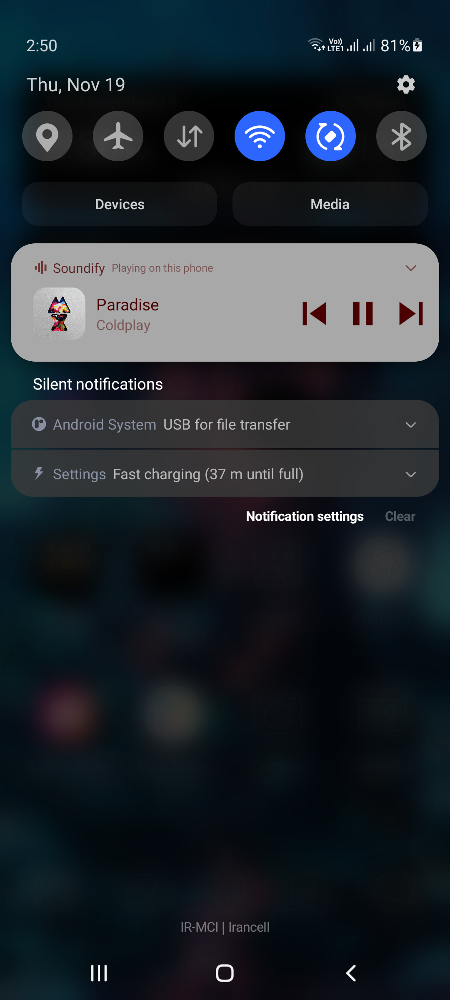

<div dir="rtl" align="right">

<h1 align="center">Soundify</h1>
<p align="center">پروژهٔ میان‌ترم درس برنامه‌سازی موبایل</p>

این پروژه یک اپلیکیشن اندروید برای پخش آنلاین موسیقی است که با فلاتر و دارت پیاده‌سازی شده است. برنامه به سرور اختصاصی درس متصل می‌شود و امکانات مدیریت حساب، جست‌وجوی آهنگ، پلی‌لیست، علاقه‌مندی‌ها و پخش موسیقی در پس‌زمینه را در یک رابط فارسی ارائه می‌دهد.

سورس کامل، فایل نصب، ویدیوی اجرای برنامه و مستندات ارزیابی از لینک‌های زیر در دسترس‌اند.

## فایل‌های تحویل

<table dir="rtl" width="100%">
<thead><tr><th align="right">مورد</th><th align="right">دسترسی</th></tr></thead>
<tbody>
<tr><td>سورس کامل پروژه</td><td><a href="https://github.com/pooryaamirniya/MP_Midterm">مشاهدهٔ فایل‌های مخزن</a></td></tr>
<tr><td>فایل نصب اندروید</td><td><a href="https://github.com/pooryaamirniya/MP_Midterm/releases/download/v1.0.1/app-release.apk">دانلود برنامه</a></td></tr>
<tr><td>ویدیوی اجرای برنامه، ۲ دقیقه و ۱۸ ثانیه</td><td><a href="video/short_video.mp4">مشاهدهٔ فایل ویدیو</a> · <a href="https://github.com/pooryaamirniya/MP_Midterm/releases/download/v1.0.1/short_video.mp4">دانلود ویدیو</a></td></tr>
<tr><td>آرشیو سورس بدون خروجی‌های ساخت</td><td><a href="https://github.com/pooryaamirniya/MP_Midterm/releases/download/v1.0.1/soundify-source.zip">دانلود آرشیو سورس</a></td></tr>
<tr><td>فایل متنی لینک‌های تحویل</td><td><a href="SUBMISSION_LINKS.txt">مشاهدهٔ همهٔ لینک‌ها</a></td></tr>
<tr><td>تطبیق با صورت پروژه</td><td><a href="docs/REQUIREMENTS.fa.md">جدول نیازمندی‌ها و پیاده‌سازی</a></td></tr>
<tr><td>آزمون‌ها و محدودیت‌های سرور</td><td><a href="docs/TEST_REPORT.fa.md">گزارش آزمون</a></td></tr>
</tbody>
</table>

<ul>
<li>نسخهٔ برنامه: <code dir="ltr">1.0.1</code></li>
<li>حداقل سیستم‌عامل: <span dir="ltr">Android 7.0 (API 24)</span></li>
<li>معماری فایل نصب: <code dir="ltr">arm64-v8a</code></li>
<li>برای آزمون بیومتریک، اثر انگشت یا چهره باید در تنظیمات دستگاه ثبت شده باشد.</li>
</ul>

<p align="center" dir="ltr">



</p>

## پیش‌نیازها و اجرای پروژه

<ul>
<li>نسخهٔ استفاده‌شدهٔ فلاتر: <code dir="ltr">Flutter 3.47.7</code>؛ نسخهٔ دارت: <code dir="ltr">Dart 3.13.5</code></li>
<li>ابزار توسعهٔ اندروید: <code dir="ltr">Android SDK 36</code> و جاوای سازگار با <code dir="ltr">Gradle 9.3.1</code></li>
<li>گوشی یا شبیه‌ساز اندروید با حداقل سطح ۲۴ و اتصال اینترنت</li>
</ul>

دستورهای زیر از ریشهٔ پروژه اجرا می‌شوند. شناسهٔ دستگاه را از خروجی دستور دوم انتخاب کنید و در دستور سوم جایگزین کنید.

<div dir="ltr" align="left">

```sh
flutter pub get
flutter devices
flutter run -d DEVICE_ID
```

</div>

در شبکه‌هایی که مخزن بسته‌های دارت در دسترس نیست، می‌توان آینهٔ دریافت بسته‌ها را برای همان نشست پاورشل تنظیم کرد:

<div dir="ltr" align="left">

```powershell
$env:PUB_HOSTED_URL = 'https://pub.flutter-io.cn'
flutter pub get
```

</div>

برنامه به کلید جداگانهٔ وب‌سرویس نیاز ندارد. برای حساب جدید، ثبت‌نام و تأیید ایمیل از داخل برنامه انجام می‌شود؛ رمز عبور حداقل ۸ کاراکتر است.

### آدرس‌های سرور

<ul>
<li>آدرس پایهٔ وب‌سرویس: <a href="https://soundify.easyfound.ir/api/v1"><code dir="ltr">https://soundify.easyfound.ir/api/v1</code></a></li>
<li>مستندات تعاملی: <a href="https://soundify.easyfound.ir/docs">مستندات سرور درس</a></li>
<li>قرارداد ثبت‌شدهٔ وب‌سرویس: <a href="docs/openapi.json">فایل قرارداد</a></li>
</ul>

## قابلیت‌های برنامه

- نمایش لوگو و صفحهٔ شروع؛ معرفی سه‌صفحه‌ای فقط در اولین اجرای پس از نصب
- ثبت‌نام، ورود، درخواست و تأیید کد ایمیل، شمارش معکوس ارسال مجدد و بازیابی دو مرحله‌ای رمز
- ذخیرهٔ امن توکن‌ها، تمدید خودکار نشست، ورود بیومتریک و نمایش وضعیت روت یا شبیه‌ساز
- کاتالوگ منتخب‌ها و همهٔ آهنگ‌ها، صفحه‌بندی، فیلتر خواننده و جست‌وجوی آنلاین با مکث ۴۵۰ میلی‌ثانیه‌ای
- ساخت، ویرایش و حذف پلی‌لیست؛ افزودن و حذف آهنگ؛ همگام‌سازی علاقه‌مندی‌ها با سرور
- حالت‌های بارگذاری، فهرست خالی و خطا با امکان تلاش مجدد
- پخش آنلاین، صف آهنگ‌ها، پخش و توقف، آهنگ بعدی و قبلی، تغییر موقعیت پخش، انتقال خودکار، تکرار و پخش تصادفی
- مینی‌پلیر در صفحات برنامه و پلیر کامل با کاور، زمان‌ها و نمایش متحرک وضعیت پخش
- ادامهٔ پخش در پس‌زمینه و هنگام خاموشی صفحه، همراه اعلان و کنترل‌های صوتی اندروید

مسیر پیاده‌سازی هر بند صورت پروژه در [جدول نیازمندی‌ها](docs/REQUIREMENTS.fa.md) و ساختار فنی در [مستند معماری](docs/ARCHITECTURE.fa.md) آمده است.

### تفاوت قرارداد کد تأیید با متن تکلیف

در قرارداد فعلی سرور، نسخهٔ <code dir="ltr">1.1.0</code>، مسیر <code dir="ltr">/auth/otp/verify</code> فقط تأیید ایمیل را برمی‌گرداند و توکن صادر نمی‌کند. این رفتار با دریافت توکن از کد یک‌بارمصرف در متن تکلیف تفاوت دارد.

در برنامه، درخواست کد، تأیید و شمارش معکوس پیاده‌سازی شده‌اند. پس از تأیید ثبت‌نام، ورود با رمز عبور از مسیر <code dir="ltr">/auth/login</code> تکمیل می‌شود. پذیرش پاسخ حاوی توکن نیز پیاده‌سازی شده است؛ اگر سرور چنین پاسخی بدهد، نشست ذخیره و در صورت نیاز پروفایل دریافت می‌شود.

## کتابخانه‌ها

<table dir="rtl" width="100%">
<thead><tr><th align="right">کتابخانه</th><th align="right">کاربرد</th></tr></thead>
<tbody>
<tr><td dir="ltr" align="left"><code>dio</code></td><td>شبکه، زمان انتظار، لغو درخواست و تمدید توکن</td></tr>
<tr><td dir="ltr" align="left"><code>provider</code></td><td>مدیریت وضعیت برنامه</td></tr>
<tr><td dir="ltr" align="left"><code>flutter_secure_storage</code></td><td>ذخیرهٔ رمزنگاری‌شدهٔ نشست</td></tr>
<tr><td dir="ltr" align="left"><code>shared_preferences</code></td><td>ثبت وضعیت مشاهدهٔ معرفی اولیه</td></tr>
<tr><td dir="ltr" align="left"><code>local_auth</code></td><td>احراز هویت بیومتریک سیستم‌عامل</td></tr>
<tr><td dir="ltr" align="left"><code>just_audio</code></td><td>استریم صوت، صف آهنگ‌ها و تغییر موقعیت پخش</td></tr>
<tr><td dir="ltr" align="left"><code>just_audio_background</code></td><td>پخش پس‌زمینه، اعلان و کنترل‌های صوتی اندروید</td></tr>
<tr><td dir="ltr" align="left"><code>audio_session</code></td><td>مدیریت نشست صوتی و تداخل صدا</td></tr>
<tr><td dir="ltr" align="left"><code>flutter_test</code><br /><code>integration_test</code><br /><code>flutter_lints</code></td><td>تست و تحلیل کد</td></tr>
</tbody>
</table>

نسخه‌های دقیق وابستگی‌ها در <code dir="ltr">pubspec.lock</code> ثبت شده‌اند. برای سازگاری با رابط‌های تولیدشدهٔ افزونه‌های اندروید، نسخهٔ <code dir="ltr">jni</code> روی <code dir="ltr">1.1.2</code> ثابت شده است. فونت محلی وزیرمتن با [مجوز آزاد فونت](assets/fonts/OFL.txt) توزیع می‌شود.

## آزمون‌ها

<div dir="ltr" align="left">

```sh
flutter analyze
flutter test
flutter test integration_test/app_test.dart -d DEVICE_ID --no-uninstall
```

</div>

۲۴ تست واحد و رابط، تحلیل کد و آزمون اصلی دستگاه واقعی با موفقیت اجرا شده‌اند. آزمون دستگاه می‌تواند از حساب ذخیره‌شده و تأیید بیومتریک استفاده کند. برای آزمون با حساب جداگانه، روش ورود و فعال‌سازی عملیات زنده در [راهنمای ساخت و آزمون](docs/BUILD.fa.md) آمده است. نتیجهٔ بررسی‌های واقعی، بازآزمایی علاقه‌مندی‌ها و وضعیت پاسخ‌گویی استریم سرور در [گزارش آزمون](docs/TEST_REPORT.fa.md) ثبت شده‌اند.

## ساخت فایل نصب

<div dir="ltr" align="left">

```sh
flutter build apk --release --target-platform android-arm64 --split-per-abi
```

</div>

خروجی ساخت در مسیر زیر قرار می‌گیرد:

<div dir="ltr" align="left">

```text
build/app/outputs/flutter-apk/app-arm64-v8a-release.apk
```

</div>

فایل نصب تحویلی با کلید اختصاصی امضا شده است. اطلاعات امضا و کلید خصوصی در مخزن قرار ندارند. جزئیات پیکربندی امضا و ساخت در [راهنمای ساخت](docs/BUILD.fa.md) و اثر انگشت فایل نصب در [فایل بررسی صحت](submission/SHA256SUMS.txt) موجود است.

## ساختار پروژه

<table dir="rtl" width="100%">
<thead><tr><th align="right">مسیر</th><th align="right">محتوا</th></tr></thead>
<tbody>
<tr><td dir="ltr" align="left"><code>lib/core/</code></td><td>مدل‌ها، شبکه، ذخیرهٔ نشست و اعتبارسنجی</td></tr>
<tr><td dir="ltr" align="left"><code>lib/state/</code></td><td>وضعیت حساب، کتابخانه و پلیر</td></tr>
<tr><td dir="ltr" align="left"><code>lib/ui/</code></td><td>صفحات و اجزای رابط کاربری</td></tr>
<tr><td dir="ltr" align="left"><code>android/</code></td><td>سرویس صوتی، بیومتریک و بررسی دستگاه</td></tr>
<tr><td dir="ltr" align="left"><code>test/</code><br /><code>integration_test/</code></td><td>آزمون‌های واحد، رابط و دستگاه</td></tr>
<tr><td dir="ltr" align="left"><code>tools/</code></td><td>آزمون مستقل سرور و بسته‌بندی سورس</td></tr>
<tr><td dir="ltr" align="left"><code>docs/</code></td><td>معماری، راهنمای ساخت، نیازمندی‌ها و گزارش آزمون</td></tr>
<tr><td dir="ltr" align="left"><code>submission/</code></td><td>فایل نصب و بررسی صحت آن</td></tr>
<tr><td dir="ltr" align="left"><code>video/short_video.mp4</code></td><td>ویدیوی اجرای برنامه</td></tr>
</tbody>
</table>

</div>
