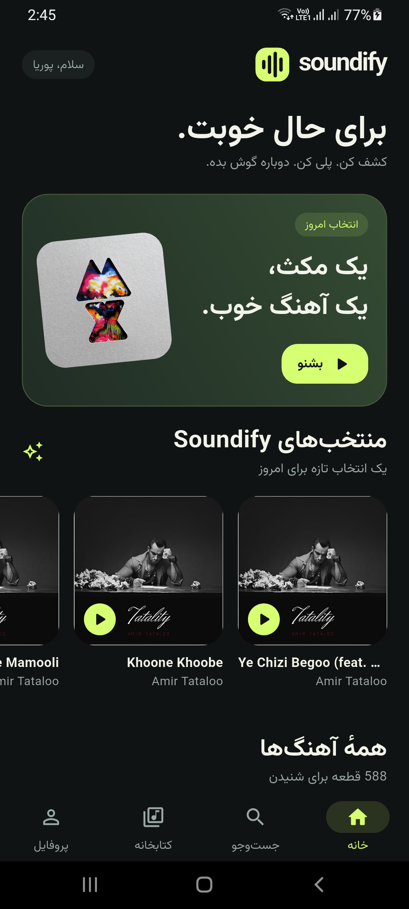
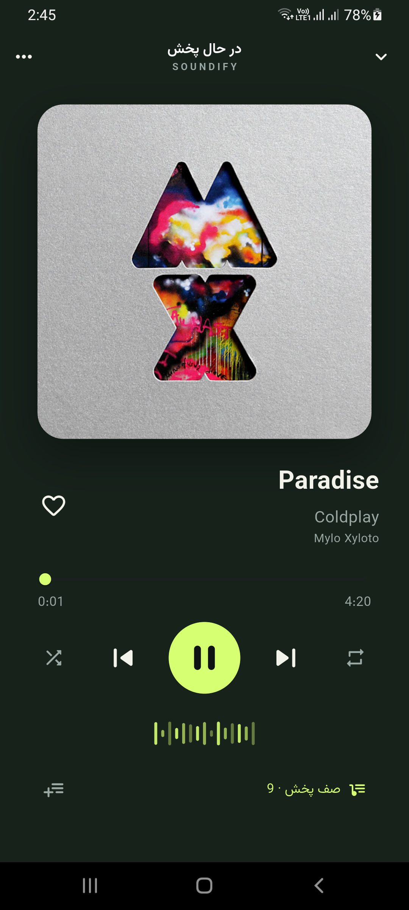

# Soundify

پروژهٔ میان‌ترم برنامه‌سازی موبایل — اپلیکیشن اندروید استریم موسیقی با **Flutter و Dart**، رابط فارسی راست‌چین و حالت تاریک.

## فایل‌های تحویل

| مورد | لینک |
| --- | --- |
| سورس کامل | [فایل‌های مخزن](https://github.com/pooryaamirniya/MP_Midterm) |
| APK نسخهٔ release برای arm64-v8a | [دانلود app-release.apk](https://github.com/pooryaamirniya/MP_Midterm/raw/refs/heads/main/submission/app-release.apk) |
| آرشیو سورس بدون build | [دانلود soundify-source.zip](https://github.com/pooryaamirniya/MP_Midterm/releases/download/v1.0.1/soundify-source.zip) |
| لینک‌های تحویل در فایل Text | [SUBMISSION_LINKS.txt](SUBMISSION_LINKS.txt) |
| ویدیوی ارائه | [پوشهٔ video](video/) — هنوز اضافه نشده است |
| تطبیق نیازمندی‌های پروژه | [جدول قابلیت‌ها و مسیر پیاده‌سازی](docs/REQUIREMENTS.fa.md) |
| گزارش آزمون | [TEST_REPORT.fa.md](docs/TEST_REPORT.fa.md) |

نسخهٔ APK: **1.0.1**، حداقل Android **7.0 / API 24**، معماری **arm64-v8a**. اثر انگشت یا چهره برای آزمون بیومتریک باید در تنظیمات دستگاه ثبت شده باشد.

<p align="center">
  
  
  
</p>

## پیش‌نیازها و اجرا

- Flutter stable با Dart **3.13.5** یا جدیدتر؛ نسخهٔ استفاده‌شده: **Flutter 3.47.7**.
- Android SDK 36 و Java سازگار با Gradle 9.3.1.
- دستگاه یا شبیه‌ساز Android API 24 به بالا و اتصال اینترنت.

```sh
flutter pub get
flutter devices
flutter run -d DEVICE_ID
```

در شبکه‌هایی که pub.dev در دسترس نیست، می‌توان mirror را برای همان نشست PowerShell تنظیم کرد:

```powershell
$env:PUB_HOSTED_URL = 'https://pub.flutter-io.cn'
flutter pub get
```

سرور برنامه به تنظیم کلید API نیاز ندارد:

```text
Base URL: https://soundify.easyfound.ir/api/v1
API documentation: https://soundify.easyfound.ir/docs
OpenAPI schema: https://soundify.easyfound.ir/schema
```

برای حساب جدید، ثبت‌نام و تأیید کد واقعی ایمیل انجام می‌شود. رمز عبور حداقل ۸ کاراکتر است. حساب یا رمز از پیش ساخته‌شده در سورس وجود ندارد.

## قابلیت‌ها

- لوگو و Splash، اسلایدر معرفی سه‌صفحه‌ای فقط در اولین اجرای پس از نصب.
- ثبت‌نام، ورود، درخواست و تأیید کد ایمیل، شمارش معکوس ارسال مجدد و بازیابی دو مرحله‌ای رمز عبور.
- ذخیرهٔ رمزنگاری‌شدهٔ Access/Refresh Token با `flutter_secure_storage`؛ SharedPreferences فقط برای وضعیت معرفی اولیه.
- تمدید خودکار توکن با Dio interceptor، چرخش refresh، اشتراک درخواست تمدید بین درخواست‌های هم‌زمان و یک بار بازپخش درخواست.
- فعال‌سازی بیومتریک، ورود با حسگر واقعی، قفل دسترسی حساب در پس‌زمینه و نمایش وضعیت روت/شبیه‌ساز.
- کاتالوگ منتخب‌ها و همهٔ آهنگ‌ها، صفحه‌بندی، فیلتر خواننده و نمایش عنوان، خواننده، آلبوم، کاور و مدت آهنگ.
- جست‌وجوی آنلاین با debounce برابر ۴۵۰ میلی‌ثانیه، لغو درخواست قبلی و جلوگیری از نمایش پاسخ دیررس.
- CRUD پلی‌لیست، ویرایش نام و توضیحات، افزودن/حذف آهنگ و مدیریت علاقه‌مندی‌ها با همگام‌سازی سرور.
- حالت‌های Loading، Empty و Error/Retry و بازگرداندن تغییر خوش‌بینانهٔ لایک هنگام خطا.
- پخش مستقیم از سرور، صف پخش، Play/Pause/Next/Previous، seek و زمان‌ها، انتقال خودکار قطعه، shuffle و repeat.
- مینی‌پلیر در صفحات اپ از جمله صفحهٔ ورود بیومتریک، پلیر کامل با کاور و نمایش متحرک ریتم پخش.
- سرویس صوتی پس‌زمینه، اعلان و کنترل‌های MediaSession و صفحهٔ قفل؛ ادامهٔ پخش هنگام خاموش‌شدن صفحه.

### قرارداد OTP سرور

در OpenAPI نسخهٔ **1.1.0**، پاسخ موفق `/auth/otp/verify` فقط `message` و `verified` دارد و توکن صادر نمی‌کند. این موضوع با متن جدول تکلیف که دریافت توکن از این مسیر را ذکر می‌کند تفاوت دارد. اپ درخواست و تأیید کد و شمارش معکوس را پیاده‌سازی می‌کند؛ پس از تأیید ثبت‌نام، ورود از `/auth/login` تکمیل می‌شود. اگر پاسخ OTP شامل Access/Refresh Token باشد، اپ آن را می‌پذیرد و در صورت نبودن پروفایل، `/users/me` را دریافت می‌کند. شرح قرارداد در [معماری](docs/ARCHITECTURE.fa.md) و [OpenAPI](docs/openapi.json) موجود است.

## کتابخانه‌ها

| کتابخانه | کاربرد |
| --- | --- |
| `dio` | کلاینت شبکه، timeout، cancellation و interceptor |
| `provider` | مدیریت وضعیت با ChangeNotifier |
| `flutter_secure_storage` | ذخیرهٔ امن و رمزنگاری‌شدهٔ نشست |
| `shared_preferences` | وضعیت مشاهدهٔ onboarding |
| `local_auth` | احراز هویت بیومتریک سیستم‌عامل |
| `just_audio` | استریم، صف پخش و seek |
| `just_audio_background` | پخش پس‌زمینه، اعلان و MediaSession |
| `audio_session` | مدیریت نشست صوتی و تداخل صوت |
| `flutter_test`, `integration_test`, `flutter_lints` | تست و تحلیل کد |

نسخه‌های دقیق در `pubspec.lock` ثبت شده‌اند. `jni` برای سازگاری با bindingهای پلاگین‌های Android روی **1.1.2** ثابت شده است. فونت محلی Vazirmatn با مجوز SIL Open Font License در `assets/fonts/OFL.txt` توزیع می‌شود.

## آزمون‌ها

```sh
flutter analyze
flutter test
```

تست‌های واحد، ورودی‌ها، صفحه‌بندی، تمدید هم‌زمان توکن، حفظ نشست در قطع شبکه، ابطال refresh، خروج حین ذخیره، قفل بیومتریک حین تمدید و تغییرات هم‌زمان علاقه‌مندی‌ها را بررسی می‌کنند.

تست دستگاه واقعی با حساب ذخیره‌شده و بیومتریک یا فایل محلی اطلاعات حساب قابل اجراست:

```sh
flutter test integration_test/app_test.dart -d DEVICE_ID --no-uninstall
```

برای ورود از فرم می‌توان یک فایل محلی خارج از مخزن با کلیدهای `TEST_EMAIL` و `TEST_PASSWORD` به `--dart-define-from-file` داد. گزینهٔ `--dart-define=TEST_MUTATIONS=true` آزمون CRUD زنده را فعال می‌کند؛ پلی‌لیست موقت حذف و وضعیت اولیهٔ لایک بازگردانده می‌شود.

آزمون مستقل API با Python 3:

```sh
python tools/api_smoke.py --account /path/to/private-account.json
```

این فایل محلی باید `email` و `password` داشته باشد. رمز و توکن در خروجی تست چاپ نمی‌شوند و اطلاعات حساب در مخزن قرار نمی‌گیرد.

## ساخت release

```sh
flutter build apk --release --target-platform android-arm64 --split-per-abi
```

خروجی Flutter در `build/app/outputs/flutter-apk/app-arm64-v8a-release.apk` است و نسخهٔ تحویلی با نام `submission/app-release.apk` قرار دارد. shrinking کد و منابع فعال است؛ منابع اعلان و کنترل‌های صوتی در `res/raw/keep.xml` حفظ می‌شوند.

امضای اختصاصی از فایل محلی `android/key.properties` خوانده می‌شود:

```properties
storePassword=YOUR_STORE_PASSWORD
keyPassword=YOUR_KEY_PASSWORD
keyAlias=soundify
storeFile=C:/path/outside/project/soundify-release.jks
```

Keystore و اطلاعات امضا در مخزن نیستند. بدون فایل امضای محلی، build برای اجرای توسعه از کلید debug استفاده می‌کند. APK تحویلی با کلید اختصاصی امضا شده و SHA-256 آن در `submission/SHA256SUMS.txt` قرار دارد.

## ساختار سورس

```text
lib/core/         مدل‌ها، شبکه، ذخیرهٔ نشست و اعتبارسنجی
lib/state/        کنترل وضعیت حساب، کتابخانه و پلیر
lib/ui/           صفحات و کامپوننت‌های رابط
android/          سرویس صوتی، بیومتریک و بررسی دستگاه
test/             تست‌های واحد و رابط
integration_test/ تست روی دستگاه واقعی
tools/            آزمون API و بسته‌بندی سورس
docs/             معماری، نیازمندی‌ها، گزارش آزمون و قرارداد API
submission/       APK و checksum تحویل
video/            ویدیوی ارائه پس از اضافه‌شدن
```
